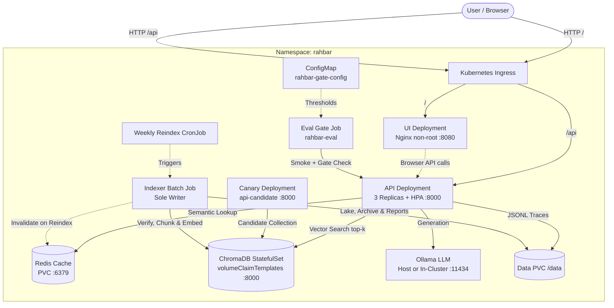

# RAHBAR: Grounded RAG on Kubernetes

[](https://github.com/o0on/rahbar/actions/workflows/ci.yml)
[](https://github.com/o0on/rahbar/actions/workflows/cd.yml)
[](LICENSE)
[](https://kubernetes.io)

RAHBAR is a production-grade, grounded Question-Answering and RAGOps platform running on Kubernetes. It indexes university policies and academic handbooks through a verified data-lake pipeline, enforces schema-constrained answers with precise citations, abstains honestly when information is missing or poisoned, traces every query end-to-end, and gates candidate releases with an automated evaluation suite.

---

## Architecture Overview

RAHBAR is built on a single-writer, multi-reader RAGOps architecture:
- **Ingestion & Data-Lake Write Path**: Verification, deduplication, quarantine, archiving, chunking, and embedding execute exclusively via Kubernetes **Jobs** (`batch/v1`) or the weekly **CronJob**. It writes vectors/metadata to ChromaDB, persists lake/archive/verify state on `rahbar-data` (`/data`), and flushes the Redis semantic cache.
- **Query Read Path**: The API service runs as a 3-replica **Deployment** with HPA autoscaling (3–8 replicas). It reads from ChromaDB and Redis, writes per-request JSON traces (`TRACE_PATH=/data/traces/trace.jsonl`), and **never writes** to the index.
- **Evaluation Gate & Canary Rollout (A3)**: `job/rahbar-eval` reads release thresholds from ConfigMap `rahbar-gate-config`, while `deploy/api-candidate` (`svc/api-candidate`) serves isolated candidate collections (`rahbar-v2-tuned`) with `maxSurge: 1`, `maxUnavailable: 0`, and instant `kubectl rollout undo`.



---

## API Contract

The API exposes the following endpoints:

| Method | Endpoint | Description | Dependencies Touched |
| :--- | :--- | :--- | :--- |
| GET | /healthz | **Liveness Probe**: Confirms Python process is responsive. | **None** (prevents restart storms) |
| GET | /readyz | **Readiness Probe**: Checks Chroma reachable, collection non-empty (`count() > 0`), Redis reachable, and model pin match. | Chroma, Redis, ConfigMap pin |
| GET | /metrics | **Prometheus Metrics**: Latency histograms, request counters, cache hits, token metrics. | In-memory metrics registry |
| POST | /api/ask | **Query Endpoint**: Validates query, semantic cache check, top-k retrieval with superseded filtering, schema validation, fallback. | Chroma, Redis, LLM Provider |

### Sample Question Payload (`POST /api/ask`)
```json
{
  "question": "What is the minimum attendance required to appear in final exams?"
}
```

### Sample Answer Contract (`AskResponse`)
```json
{
  "request_id": "7b8df5f5-req-01",
  "answer": "A student must maintain a minimum of 80% attendance in each registered course to be eligible to appear in the final examination [Academic Rules Handbook / Section 1.21].",
  "citations": [
    {
      "source": "Academic_Rules_Handbook_2026.pdf",
      "section": "1.21 Attendance Policy",
      "page": 14
    }
  ],
  "answered_from_context": true,
  "confidence": "high",
  "retrieved": [
    {
      "chunk_id": "rule-chunk-102",
      "source": "Academic_Rules_Handbook_2026.pdf",
      "section": "1.21 Attendance Policy",
      "page": 14,
      "score": 0.89
    }
  ],
  "provider": "ollama-host"
}
```

---

## Local Cluster Quickstart

### Prerequisites
- Docker Engine
- Minikube or Kind
- Kubectl & Kustomize
- Python 3.12+

### 1. Start Cluster with Calico & Addons
```bash
# Calico CNI is required for enforcing Kubernetes NetworkPolicy
minikube start --driver=docker --cni=calico --memory=6144 --cpus=4
minikube addons enable metrics-server
minikube addons enable ingress
```

### 2. Configure Host Ollama (Default Provider)
```bash
# Listen on all interfaces so pods reach host.minikube.internal:11434
OLLAMA_HOST=0.0.0.0 ollama serve
ollama pull llama3.2:3b
ollama pull nomic-embed-text
```

---

## Exact Kubernetes Deployment Order

Apply the manifests in the exact sequence documented below. The repository uses Kustomize overlays:

```bash
# 1. Create the Secret out-of-band (never committed to Git)
kubectl create namespace rahbar
kubectl create secret generic rahbar-secret \
  -n rahbar \
  --from-literal=LLM_API_KEY="local-dev-token"

# 2. Apply all base manifests using Kustomize
kubectl apply -k k8s/overlays/prod

# 3. Wait for data tier rollout
kubectl rollout status statefulset/chroma -n rahbar --timeout=120s
kubectl rollout status deployment/redis -n rahbar --timeout=120s

# 4. Run the Indexer Job to populate the vector store
# The API will report 0/1 READY until the index exists!
kubectl create job --from=cronjob/reindex manual-indexer-bootstrap -n rahbar
kubectl wait --for=condition=complete job/manual-indexer-bootstrap -n rahbar --timeout=300s

# 5. Verify API replicas become READY (3/3)
kubectl rollout status deployment/api -n rahbar --timeout=180s
kubectl rollout status deployment/ui -n rahbar --timeout=60s
```

---

## Re-Indexing Without Redeployment

To re-index when new university documents are published, execute a one-shot Job from the CronJob template without modifying or restarting the API:

```bash
kubectl create job --from=cronjob/reindex manual-reindex-1 -n rahbar
```

The Job chunks and embeds the new corpus, updates ChromaDB metadata, and invalidates the Redis semantic cache atomically.

---

## Corpus & MANIFEST

External university PDF documents are not tracked directly in Git history. Run the fetch script to retrieve and verify them:

```bash
python corpus/fetch.py
```
This verifies document SHA-256 checksums recorded in `corpus/MANIFEST.md`.

---

## Assignment 03 — RAGOps Workflow & Exact Commands (Ashar: A, D, F data plane | Aun: B, C, E, F release)

The A3 stack runs on a local `kind` cluster (context `kind-rahbar`) with `k8s/overlays/dev` and host/in-cluster Ollama (`nomic-embed-text` + `llama3.2:3b`). See the companion docs for full design, contracts, and threshold justifications:
- Work split & contracts: [`docs/A3-WORK-SPLIT.md`](docs/A3-WORK-SPLIT.md)
- Data-plane setup & PowerShell commands: [`docs/A3-ASHAR-COMMANDS.md`](docs/A3-ASHAR-COMMANDS.md)
- Evaluation suite & gate thresholds: [`docs/EVAL.md`](docs/EVAL.md)
- Release gate & canary manifests guide: [`k8s/README.md`](k8s/README.md)
- Final Assignment 03 report: [`report/A3-Report.pdf`](report/A3-Report.pdf) ([`.docx`](report/A3-Report.docx))

### A — data management

```bash
# First build (Batch A), then A1 verification of Batch B:
kubectl -n rahbar create job --from=cronjob/reindex ingest-batch-a
kubectl -n rahbar wait --for=condition=complete job/ingest-batch-a --timeout=900s
kubectl apply -f k8s/jobs/verify-batch-b.yaml
kubectl -n rahbar logs -f job/a3-verify-batch-b

# First Batch B ingest, then the identical re-ingest:
kubectl apply -f k8s/jobs/ingest-batch-b.yaml
kubectl -n rahbar wait --for=condition=complete job/a3-ingest-batch-b --timeout=600s
kubectl apply -f k8s/jobs/ingest-batch-b-unchanged.yaml
kubectl -n rahbar logs -f job/a3-ingest-batch-b-unchanged
# expected: INCREMENTAL RESULT  chunks_embedded=0  chunks_reused=93
```

### D — tracing and observability

```bash
kubectl -n rahbar port-forward svc/api 8000:8000
curl -s -i -X POST http://127.0.0.1:8000/api/ask \
  -H 'Content-Type: application/json' \
  -d '{"question":"What is the academic probation rule?"}'
# copy the x-trace-id header, then:
POD=$(kubectl -n rahbar get pods -l app.kubernetes.io/name=api -o jsonpath='{.items[0].metadata.name}')
kubectl -n rahbar cp ${POD}:/data/traces/trace.jsonl traces/trace.jsonl
python scripts/trace_tool.py <TRACE_ID> --path traces/trace.jsonl
python scripts/trace_summary.py --hours 24 --path traces/trace.jsonl
```

### F — data plane (Ashar's manifests)

```bash
kubectl -n rahbar get all,pvc,configmap,cronjob,job
kubectl -n rahbar get deploy api -o yaml | grep -A3 -E 'data|mountPath|claimName'
```

### B — 3-level evaluation suite (Aun)

```bash
# Run Module + Component + E2E + typo noise + dual-seed determinism in one command:
make a3-eval
# Or explicitly:
python eval/suite.py --api http://127.0.0.1:8080 --collection rahbar --seed 42 --compare-seed 43
```

### C — change experiment & release gate (Aun)

```bash
# Evaluates bad candidate (chunk=100, overlap=0, top_k=1 -> FAIL) vs tuned candidate (hybrid rerank -> PASS):
python eval/change_experiment.py --baseline eval/results/20261126T113607Z.json \
  --chroma-host 127.0.0.1 --chroma-port 8001 --ollama-url http://127.0.0.1:11434
# Standalone gate verification:
python eval/gate.py --baseline eval/results/20261126T113607Z.json --candidate eval/results/change/bad-candidate.json
python eval/gate.py --baseline eval/results/20261126T113607Z.json --candidate eval/results/change/good-candidate.json
```

### E — live query coverage & Batch B drift (Aun)

```bash
# Measure coverage before/after adding 6 Batch B golden questions + Batch B drift:
python eval/coverage.py --live eval/live_queries.jsonl --golden eval/golden.jsonl --out eval/results/coverage/after.json
python eval/drift_check.py
```

### F — release & eval manifests (Aun: F2, F3, F5)

```bash
# Run in-cluster evaluation Job & demonstrate ConfigMap-only gate flip (no image rebuild):
kubectl apply -f k8s/base/eval-job.yaml && kubectl -n rahbar logs -f job/rahbar-eval
kubectl -n rahbar patch configmap rahbar-gate-config --type merge -p '{"data":{"P95_MS_MAX":"50"}}'
kubectl -n rahbar delete job rahbar-eval --ignore-not-found && kubectl apply -f k8s/base/eval-job.yaml
kubectl -n rahbar logs -f job/rahbar-eval          # expected: GATE FAIL (exit 1)
kubectl apply -f k8s/base/gate-configmap.yaml    # restore

# Canary rollout & rollback verification:
kubectl -n rahbar set env deploy/api-candidate EMBED_VERSION=v2-bad CHROMA_COLLECTION=rahbar-v2-bad TOP_K=1
kubectl -n rahbar rollout status deploy/api-candidate --timeout=120s
kubectl -n rahbar rollout undo deploy/api-candidate
kubectl -n rahbar rollout status deploy/api-candidate --timeout=120s
```

### Verification, CI & Submission Checks

```bash
# Lint, type-check, unit/contract tests (>= 60% coverage gate), and submission audit:
ruff check .
mypy api/app indexer/pipeline --ignore-missing-imports
pytest api/tests indexer/tests --cov=api/app --cov=indexer/pipeline --cov-fail-under=60 -q
python scripts/check_submission.py

# Validate Kustomize overlays:
kubectl kustomize k8s/overlays/prod >/dev/null
kubectl kustomize k8s/overlays/dev  >/dev/null
kubectl kustomize k8s/overlays/ci   >/dev/null
```

### Committed A3 Evidence & Branch Flow

- **Evaluation & Gate Artifacts**:
  - Three-level suite & dual-seed runs: `eval/results/20261126T113607Z.json` (25-question baseline), `eval/results/20261127T141521Z.json` (31-question expanded run used in the report)
  - Change experiment & gate comparison: `eval/results/change/` (`bad-candidate.json`, `good-candidate.json`, `comparison.json`)
  - Query coverage & Batch B drift: `eval/results/coverage/` (`before.json`, `after.json`, `drift.json`)
  - Data verification & traces: `eval/results/verify/*.json`, `eval/results/trace-summary.json`, `traces/trace.jsonl`
  - Cluster & rollout evidence logs: `eval/results/f_evidence/`
- **Report & Screenshots**: Uncropped terminal screenshots live in `report/screenshots/`; 14 of them are embedded in the Appendix of [`report/A3-Report.docx`](report/A3-Report.docx) / [`report/A3-Report.pdf`](report/A3-Report.pdf). The byte-identical duplicate `C-PASS.png` was removed from the Appendix because `C-FAIL.png` already contains both the gate FAIL and PASS runs in one VS Code capture.
- **Branching & CI/CD**: Assignment 03 development lives on branch `a3`; `.github/workflows/ci.yml` runs automatically on pushes to `dev` and pull requests targeting `main` (never push directly to `main`), and `.github/workflows/cd.yml` publishes SHA-tagged images on merge to `main`.
