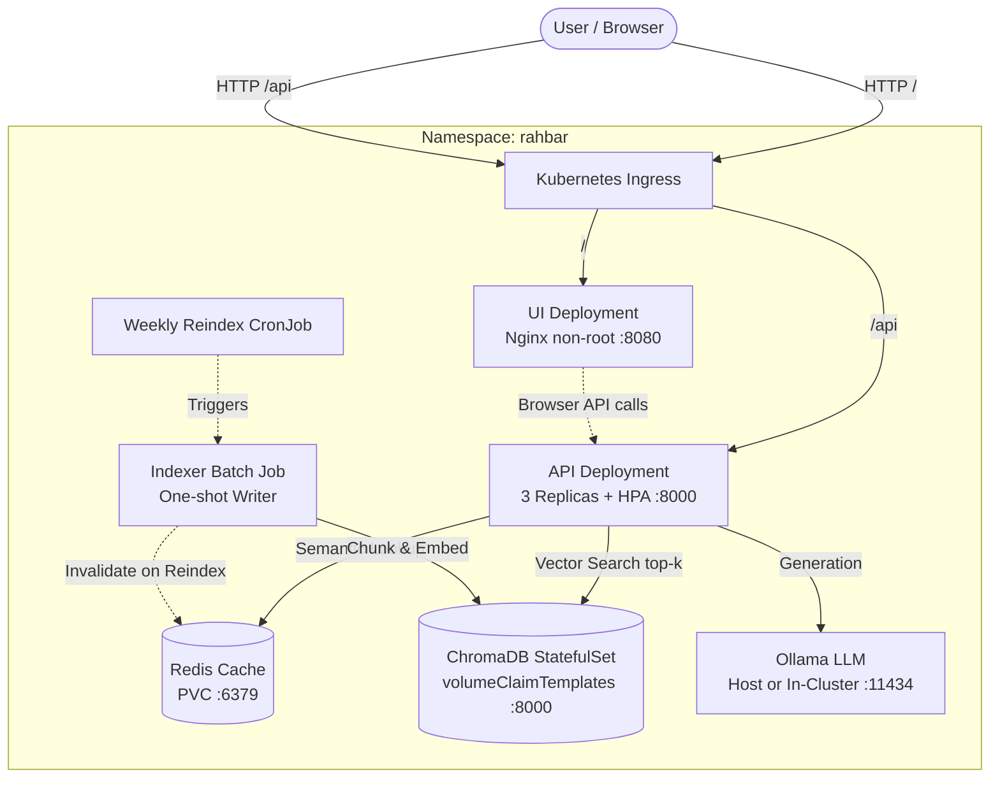

# RAHBAR: Grounded RAG on Kubernetes

[](https://github.com/o0on/rahbar/actions/workflows/ci.yml)
[](https://github.com/o0on/rahbar/actions/workflows/cd.yml)
[](LICENSE)
[](https://kubernetes.io)

RAHBAR is a production-grade, grounded Question-Answering service running on Kubernetes. It indexes real university policies and academic handbooks, enforces schema-constrained answers with precise citations, abstains honestly when information is missing, and isolates the indexing write path from query execution.

---

## Architecture Overview

RAHBAR is built on a fundamental single-writer, multi-reader architecture:
- **Indexing Write Path**: Indexing is executed exclusively on-demand via a Kubernetes **Job** (`batch/v1`) or weekly **CronJob**. It writes vectors and metadata to ChromaDB and flushes the Redis semantic cache.
- **Query Read Path**: The API service runs as a 3-replica **Deployment** with HPA autoscaling (3–8 replicas). It reads from ChromaDB and Redis; it **never writes** to the index.



---

## API Contract

The API exposes the following endpoints:

| Method | Endpoint | Description | Dependencies Touched |
| :--- | :--- | :--- | :--- |
| GET | /healthz | **Liveness Probe**: Confirms Python process is responsive. | **None** (prevents restart storms) |
| GET | /readyz | **Readiness Probe**: Checks Chroma reachable, collection non-empty (`count() > 0`), Redis reachable, and model pin match. | Chroma, Redis, ConfigMap pin |
| GET | /metrics | **Prometheus Metrics**: Latency histograms, request counters, cache hits, token metrics. | In-memory metrics registry |
| POST | /api/ask | **Query Endpoint**: Validates query, semantic cache check, top-k retrieval with superseded filtering, schema validation, fallback. | Chroma, Redis, LLM Provider |

### Sample Question Payload (`POST /api/ask`)
```json
{
  "question": "What is the minimum attendance required to appear in final exams?"
}
```

### Sample Answer Contract (`AskResponse`)
```json
{
  "request_id": "7b8df5f5-req-01",
  "answer": "A student must maintain a minimum of 80% attendance in each registered course to be eligible to appear in the final examination [Academic Rules Handbook / Section 1.21].",
  "citations": [
    {
      "source": "Academic_Rules_Handbook_2026.pdf",
      "section": "1.21 Attendance Policy",
      "page": 14
    }
  ],
  "answered_from_context": true,
  "confidence": "high",
  "retrieved": [
    {
      "chunk_id": "rule-chunk-102",
      "source": "Academic_Rules_Handbook_2026.pdf",
      "section": "1.21 Attendance Policy",
      "page": 14,
      "score": 0.89
    }
  ],
  "provider": "ollama-host"
}
```

---

## Local Cluster Quickstart

### Prerequisites
- Docker Engine
- Minikube or Kind
- Kubectl & Kustomize
- Python 3.12+

### 1. Start Cluster with Calico & Addons
```bash
# Calico CNI is required for enforcing Kubernetes NetworkPolicy
minikube start --driver=docker --cni=calico --memory=6144 --cpus=4
minikube addons enable metrics-server
minikube addons enable ingress
```

### 2. Configure Host Ollama (Default Provider)
```bash
# Listen on all interfaces so pods reach host.minikube.internal:11434
OLLAMA_HOST=0.0.0.0 ollama serve
ollama pull llama3.2:3b
ollama pull nomic-embed-text
```

---

## Exact Kubernetes Deployment Order

Apply the manifests in the exact sequence documented below. The repository uses Kustomize overlays:

```bash
# 1. Create the Secret out-of-band (never committed to Git)
kubectl create namespace rahbar
kubectl create secret generic rahbar-secret \
  -n rahbar \
  --from-literal=LLM_API_KEY="local-dev-token"

# 2. Apply all base manifests using Kustomize
kubectl apply -k k8s/overlays/prod

# 3. Wait for data tier rollout
kubectl rollout status statefulset/chroma -n rahbar --timeout=120s
kubectl rollout status deployment/redis -n rahbar --timeout=120s

# 4. Run the Indexer Job to populate the vector store
# The API will report 0/1 READY until the index exists!
kubectl create job --from=cronjob/reindex manual-indexer-bootstrap -n rahbar
kubectl wait --for=condition=complete job/manual-indexer-bootstrap -n rahbar --timeout=300s

# 5. Verify API replicas become READY (3/3)
kubectl rollout status deployment/api -n rahbar --timeout=180s
kubectl rollout status deployment/ui -n rahbar --timeout=60s
```

---

## Re-Indexing Without Redeployment

To re-index when new university documents are published, execute a one-shot Job from the CronJob template without modifying or restarting the API:

```bash
kubectl create job --from=cronjob/reindex manual-reindex-1 -n rahbar
```

The Job chunks and embeds the new corpus, updates ChromaDB metadata, and invalidates the Redis semantic cache atomically.

---

## Corpus & MANIFEST

External university PDF documents are not tracked directly in Git history. Run the fetch script to retrieve and verify them:

```bash
python corpus/fetch.py
```
This verifies document SHA-256 checksums recorded in `corpus/MANIFEST.md`.
